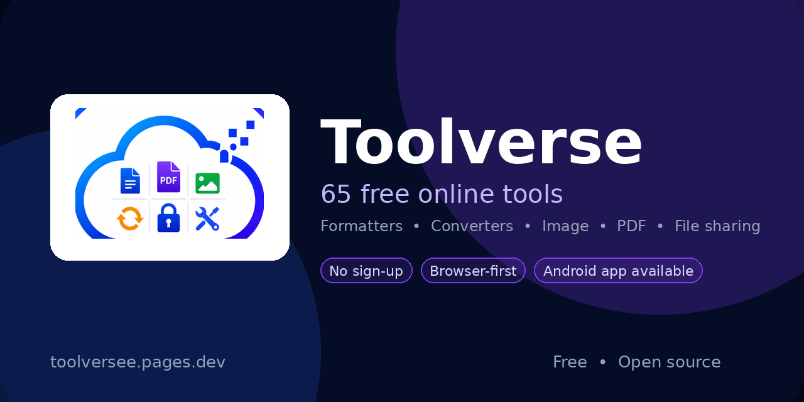
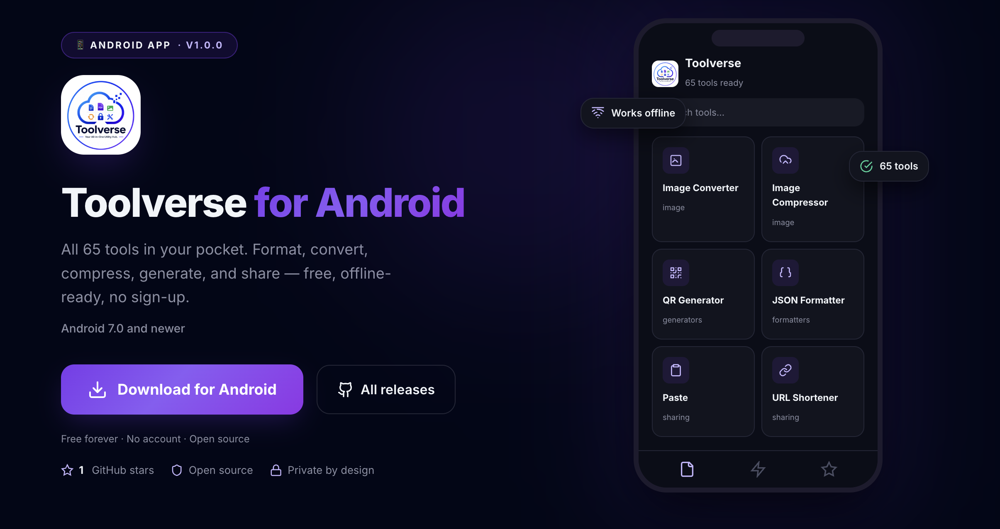
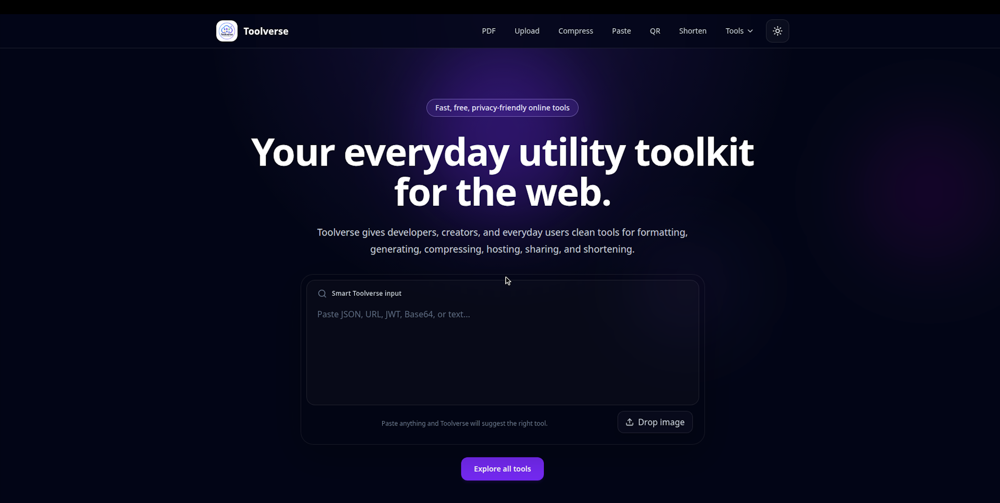
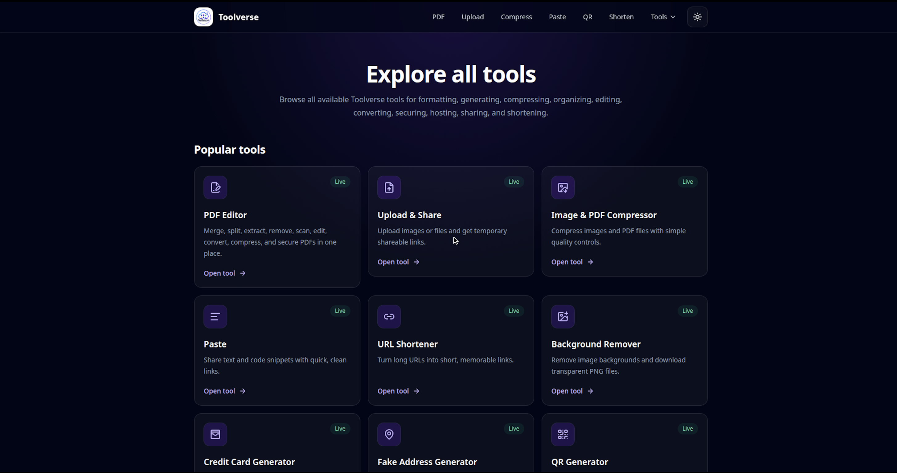
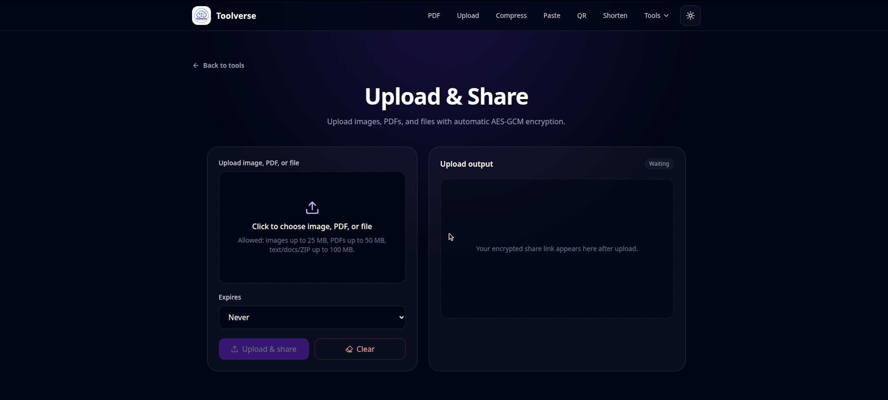

# Toolverse

[](https://github.com/Surya-1301/Toolverse/releases)
[](https://toolversee.pages.dev)
[](https://downloadtoolverse.dpdns.org/)
[](LICENSE)



**Free online utilities — formatters, converters, generators, image tools, and sharing tools, right in your browser.**

No sign-up. Most tools run entirely on your device, so your input never leaves your computer.

<div align="center">

| 🌐 Live site | 📱 Android app |
|---|---|
| [toolversee.pages.dev](https://toolversee.pages.dev) | [downloadtoolverse.dpdns.org](https://downloadtoolverse.dpdns.org/) |

</div>

---

## Mobile apps (Android & iOS)


Toolverse is available as a native mobile app wrapped with Capacitor 8 — all 59+ tools with offline-first client processing and native system integrations.

📥 **Android APK Download:** https://downloadtoolverse.dpdns.org/

- **Apple Fluid Design**: Clean frosted glassmorphism interface with custom dark/light theme support, responsive floating overlays, and touch-optimized ergonomics.
- **Offline Capable**: Most formatters, converters, and generators run 100% locally on your device with zero data leaving your phone.
- **Native Integrations**: Capacitor plugins for native sharing, local notifications, file system access, and dynamic status bar styling.
- **Automated Builds**: APKs are built with Capacitor + GitHub Actions and attached to each release tag.

> The APK is debug-signed, so Android will show an "unknown developer" warning during sideloading. This is expected for apps installed outside the Play Store.

---

## Features

59 tools across 4 categories. Every tool has its own page with step-by-step guidance and FAQs.

### Sharing & Hosting

<div align="center">

| Tool | What it does |
|---|---|
| Paste | Share text & code with a link, viewer included |
| URL Shortener | Short links with redirect tracking & expiry |
| Image Hosting | Host images with a direct link |
| File Sharing | Share files with a download link |
| Owner Dashboard | Manage your hosted files & images |
| Encrypted Uploads | Client-side encryption for shared uploads |

</div>

### Conversion Tools

<div align="center">

| Tool | What it does |
|---|---|
| Markdown to PDF | Convert Markdown documents to PDF |
| Markdown to HTML | Convert Markdown to HTML |
| YAML ↔ JSON | Convert between YAML and JSON |
| CSV ↔ JSON | Convert between CSV and JSON |
| Excel ↔ CSV | Convert between spreadsheets and CSV |
| Color Converter | Convert between RGB, HEX, and HSL |
| Regex Tester | Test regular expressions live |
| JSON ↔ XML | Convert between JSON and XML |
| Image to Base64 | Encode images as Base64 data URLs |

</div>

### Formatters

HTML Formatter · CSS Formatter · JavaScript Formatter · TypeScript Formatter · JSON Formatter · SQL Formatter

### Image Tools

<div align="center">

| Tool | What it does |
|---|---|
| Image Converter | Convert PNG, JPG, WebP, HEIC, HEIF |
| Image Compressor | Shrink images to a target file size |
| Image Resizer & Cropper | Resize and crop with live preview |
| Image Blur | Blur all or part of an image |
| Image Watermark | Add text watermarks to images |
| Background Remover | Remove image backgrounds (AI) |
| Favicon Generator | Generate favicons in every size |
| OG Image Generator | Generate Open Graph social images |
| Image Upscaler | Enlarge images |
| Image Placeholder | Generate placeholder images |
| Image Host | Host and share images |

</div>

### Text & Developer Tools

<div align="center">

| Tool | What it does |
|---|---|
| IP Lookup | Look up IP address details |
| Credit Card Generator & Validator | Generate test cards, validate with Luhn |
| Fake Address & User Generator | Realistic fake data in 16 locales |
| UUID Generator | Generate UUIDs in bulk |
| Password Generator | Secure passwords with strength analysis |
| Password Strength Checker | Score any password |
| Hash Generator | MD5, SHA-1, SHA-256, and more |
| Random String Generator | Random strings with custom alphabets |
| Base64 Encoder / Decoder | Encode & decode Base64 |
| JWT Decoder | Decode JWT headers & payloads |
| Lorem Ipsum Generator | Placeholder text in any length |
| Text Counter | Words, characters, sentences, reading time |
| Case Converter | UPPER, lower, Title, camel, snake, kebab |
| Duplicate Line Remover | Deduplicate lines in any text |
| Timestamp Converter | Unix ↔ human-readable dates |
| URL Tools | Encode, decode, parse URLs |
| Text to Speech | Read text aloud in the browser |
| Audio Converter | Convert audio formats in the browser |
| Domain Lookup | WHOIS & DNS records for any domain |
| HTTP Request Tester | Test API endpoints from the browser |
| Text Compare & Diff | Side-by-side text diff |
| Email, Phone & IBAN Validator | Validate emails, phones, IBANs |
| QR Generator | Generate QR codes for any text or URL |

</div>

### PDF Tools

The standalone PDF editor now lives on [PDFVerse](https://pdfverse.pages.dev/) — a dedicated
site with merging, splitting, extraction, conversion, compression, forms, OCR, and security
tools. On Toolverse, `/pdf-editor` and `/pdf-to-markdown` simply redirect there.

PDF compression itself remains available on Toolverse via the
[Image & PDF Compressor](/image-compressor), and Markdown to PDF stays in the
Conversion Tools category.

---

## Screenshots





---

## How it works

**Browser-first architecture.** The vast majority of tools run 100% client-side — formatters, converters, generators, and image tools never upload your input.

**Cloudflare Worker API.** Sharing tools (paste, URL shortener, image/file hosting) run on the Toolverse API — Cloudflare Workers with D1 metadata and R2 file storage.

**Image backend.** Background removal and PDF compression run on the Toolverse image API (FastAPI + remove.bg + Ghostscript).

**PDF editor.** The standalone PDF editor lives on [PDFVerse](https://pdfverse.pages.dev/); the Toolverse `/pdf-editor` and `/pdf-to-markdown` routes redirect there.

---

## Tech Stack

### Frontend & Mobile

- **Next.js 16** (App Router) + **React 19**
- **TypeScript** · **Tailwind CSS 4**
- **Capacitor 8** (`@capacitor/core`, `@capacitor/android`, `@capacitor/ios`)
- Native Capacitor plugins: `@capacitor/app`, `@capacitor/filesystem`, `@capacitor/local-notifications`, `@capacitor/share`, `@capacitor/status-bar`
- **Apple Fluid Design System**: Ultra-frosted glassmorphic cards (`.apple-glass`), specular light accents (`.apple-specular`), midnight dark mode (`#070a14`), and adaptive responsive popovers
- `pdf-lib` — client-side PDF generation
- `browser-image-compression`, `heic2any` — image workflows
- `qrcode`, `xlsx`, `lamejs`, `bcryptjs`, `lucide-react`

### Cloudflare API Worker (`backend/`)

- **Cloudflare Workers + Wrangler**
- **Cloudflare D1** — metadata
- **Cloudflare R2** — uploaded files & images

Bindings in `backend/wrangler.jsonc`: `DB` (D1), `FILES_BUCKET` (R2).

### Image Backend (`image-backend/`)

Deployed separately on Render (Docker).

- **Python + FastAPI + Uvicorn** — API
- **Pillow**, `python-multipart`, `requests` — image handling & remove.bg
- **Ghostscript** — PDF compression

---

## Project Structure

```txt
Toolverse/
├─ app/                          # Next.js App Router pages & tool routes
│  ├─ tools/                     # Tool index & category pages
│  ├─ pdf-editor/                # Redirect to PDFVerse
│  ├─ paste/, paste-view/        # Paste creation & viewing
│  ├─ file/, file-share/         # File management & sharing
│  ├─ image-*/                   # Image tools
│  └─ *-formatter/               # Code & data formatters
├─ components/                   # Shared React components
├─ lib/                          # Shared helpers, apiBase, seoTools
├─ backend/                      # Cloudflare Worker API + D1 migrations
├─ backend-routes/               # Next.js proxy routes for backend APIs
├─ image-backend/                # Python image-processing service
├─ public/                       # Static assets, icons, sitemap, robots
├─ resources/android-icons/       # Android launcher icons (Capacitor)
├─ capacitor.config.ts           # Capacitor app config
├─ .github/workflows/android.yml # GitHub Actions Android APK build
├─ wrangler.jsonc                # OpenNext / Cloudflare frontend config
└─ package.json
```

---

## Getting Started

### Prerequisites

- Node.js 22+ and npm

### 1. Clone the repository

```bash
git clone https://github.com/Surya-1301/Toolverse.git
cd Toolverse
```

### 2. Install dependencies

```bash
npm install
```

### 3. Configure environment

Create a `.env.local` file in the project root:

```env
NEXT_PUBLIC_API_BASE_URL=....
NEXT_PUBLIC_IMAGE_API_BASE_URL=....

> For local backend development, point these at your local servers (Worker `http://localhost:8787`, image `http://localhost:8000`).

### 4. Run the dev server

```bash
npm run dev
```

Open http://localhost:3000

---

## Environment Variables

<div align="center">

| Variable | Required | Description |
|---|---|---|
| `NEXT_PUBLIC_API_BASE_URL` | Yes | Base URL of the Cloudflare Worker API (sharing tools) |
| `NEXT_PUBLIC_IMAGE_API_BASE_URL` | Yes | Base URL of the image backend (background remover, PDF compression) |

</div>

> Keep local environment files out of version control. The repository ignores `.env*` files.

---

## Available Scripts

<div align="center">

| Command | Description |
|---|---|
| `npm run dev` | Start the dev server |
| `npm run build` | Production build (static export) |
| `npm run start` | Start the production server |
| `npm run lint` | Run ESLint |
| `npm run build:cloudflare` | Build with OpenNext for Cloudflare |
| `npm run preview:cloudflare` | Preview the Cloudflare build |
| `npm run deploy:cloudflare` | Build & deploy to Cloudflare Pages |
| `npm run build:mobile` | Export web build and sync to Capacitor Android & iOS |
| `npm run build:android` | Export web build and sync to Capacitor Android |
| `npm run build:ios` | Export web build and sync to Capacitor iOS |
| `npm run apk` | Build and compile debug Android APK locally |
| `npm run ios` | Build and open iOS project in Xcode |

</div>

---

## Deployment

### Frontend — Cloudflare Pages

- **Build command:** `npm run build:cloudflare`
- **Config:** `wrangler.jsonc`, `open-next.config.ts`
- **Environment variables:** `NEXT_PUBLIC_API_BASE_URL`, `NEXT_PUBLIC_IMAGE_API_BASE_URL`

Or deploy via CLI: `npm run deploy:cloudflare` (requires `wrangler` login).

### Cloudflare API — Workers

Deploy from `backend/`:

```bash
cd backend
npm install
npm run deploy
```

Run the remote D1 schema migration with:

```bash
npm run db:migrate
```

### Image Backend — Render

- **Service type:** Web Service
- **Environment:** Docker
- **Root directory:** `image-backend`
- **Dockerfile path:** `./Dockerfile`
- **Environment variable:** `REMOVEBG_API_KEY`

### Android App — GitHub Actions

The APK is built in the cloud on tag push — no Android Studio needed.

```bash
git tag -a v0.1.0 -m "v0.1.0"
git push origin v0.1.0
```

The workflow (`.github/workflows/android.yml`) builds the web app, adds the Android platform with Capacitor, and attaches the APK to the GitHub release. Manual runs: **Actions → Android APK → Run workflow**.

---

## Backend API Overview

### Cloudflare Worker API

Base URL: `NEXT_PUBLIC_API_BASE_URL`

<div align="center">

| Method | Endpoint | Description |
|---|---|---|
| `POST` | `/api/paste/create` | Create a paste |
| `GET` | `/api/paste/:id` | View a paste |
| `PUT` | `/api/paste/:id` | Update a paste |
| `POST` | `/api/shorten` | Shorten a URL |
| `GET` | `/s/:slug` | Redirect a short link |
| `POST` | `/api/image/upload` | Upload an image |
| `GET` | `/api/image/:id/direct` | Direct image link |
| `POST` | `/api/file/upload` | Upload a file |
| `GET` | `/api/file/:id/download` | Download a shared file |

</div>

### Image Backend

Base URL: `NEXT_PUBLIC_IMAGE_API_BASE_URL`

<div align="center">

| Method | Endpoint | Description |
|---|---|---|
| `GET` | `/health` | Health check |
| `POST` | `/api/image/remove-background` | Remove image background |
| `POST` | `/api/pdf/compress` | Compress a PDF (Ghostscript, quality tiers `0.01`–`0.85`) |

</div>

---

## Privacy & File Handling

- **Browser tools:** files never leave the user's device. No upload, no tracking of file contents.
- **Sharing tools:** pastes, images, and files are uploaded to the Cloudflare API (D1 + R2) so they can be shared via link.
- **Server processing:** background removal and PDF compression are processed over HTTPS; temporary copies are deleted afterward.
- Full details: https://toolversee.pages.dev/privacy
- Report abuse: https://toolversee.pages.dev/report-abuse

---

## SEO

- `public/sitemap.xml` — submitted to Search Console
- `public/robots.txt` — allows all, references sitemap
- Per-tool pages emit Open Graph / Twitter cards and `FAQPage` JSON-LD from `lib/seoTools.ts`

---

## License

MIT — see [LICENSE](LICENSE).

---

